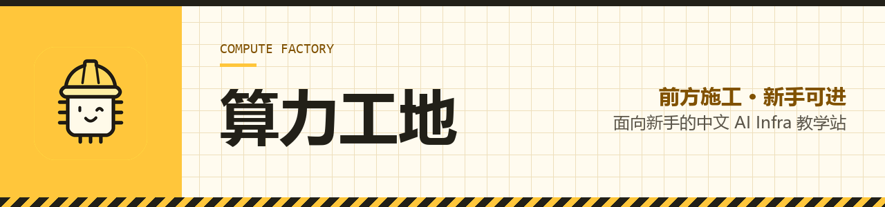

<p align="center">
  
</p>

# 算力工地 · Compute Factory

**前方施工 · 新手可进**

面向新手的中文 AI Infra 教学站。从"模型权重到底占多少显存"这种最小的问题开始，一路做到推理服务、GPU 算子和分布式训练。

[网站](https://www.compute-factory.com/) · [主题教程](https://www.compute-factory.com/guide/) · [资料架](https://www.compute-factory.com/resources.html)

---

## 怎么学

不按目录铺知识，按"先能跑起来"的顺序排：

```
入门导读      估算权重内存 → 看懂一次 token 是怎么生成的
   ↓
编程前置      遇到读不懂的语法，再回来补一小课
   ↓
推理与服务    跑通服务、测量表现、理解缓存与调度
   ↓
GPU 与算子    CUDA C++ / Triton / CUTLASS，同一个算子的三种写法
   ↓
分布式训练    多卡、并行策略、通信开销
```

每一篇教程都写清楚四件事：**读完能做什么、需要什么软硬件、要跑哪些命令、怎么判断结果对了**。

## 现在可以做什么

| 想做的事 | 去哪 |
| --- | --- |
| 第一次接触，从零开始 | [第一张工单 · 估算模型权重](https://www.compute-factory.com/guide/first-lab.html) |
| 找某个方向的资料 | [资料架](https://www.compute-factory.com/resources.html) |
| 发现内容有错 | [提勘误](https://github.com/compute-factory/compute-factory.github.io/issues/new/choose) |
| 想写一篇教程 | [先开选题 Issue](https://github.com/compute-factory/compute-factory.github.io/issues/new/choose) |

## 仓库

| 仓库 | 内容 |
| --- | --- |
| [compute-factory.github.io](https://github.com/compute-factory/compute-factory.github.io) | 站点源码：教程正文、主题组件、构建配置 |

## 参与

勘误（错别字、命令跑不通、链接失效）欢迎直接提 PR，不用先打招呼。新教程建议先开 Issue 确认选题，避免写完发现要拆或者不该收。

- [贡献指南](https://github.com/compute-factory/compute-factory.github.io/blob/main/CONTRIBUTING.md)
- [社区行为准则](https://github.com/compute-factory/compute-factory.github.io/blob/main/CODE_OF_CONDUCT.md)
- [代码架构说明](https://github.com/compute-factory/compute-factory.github.io/blob/main/ARCHITECTURE.md)

这里读者大多是刚开始接触 AI Infra 的新手。**提出基础问题不会被嘲笑**——这是这个社区存在的理由。

## 许可

教程正文与配图采用 [CC BY 4.0](https://creativecommons.org/licenses/by/4.0/deed.zh-hans)，站点代码与示例采用 [MIT](https://github.com/compute-factory/compute-factory.github.io/blob/main/LICENSE)。
